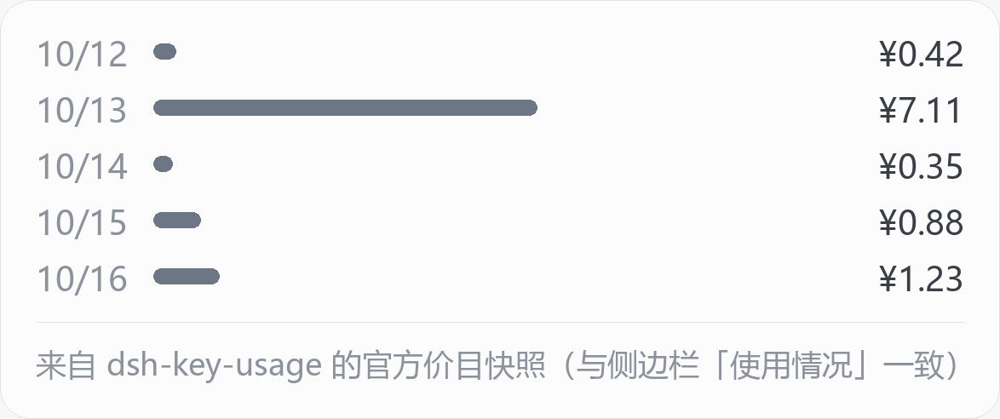

# dsh-cost-strip

给 [DeepSeek Harness](https://github.com/deepseek-ai)（DSH）用的一行消费显示：**输入框下方常驻「今日 ¥x.xx · 7 天 ¥y.yy」**，鼠标悬浮看近 7 天柱状图，点击强制刷新。

**纯本地只读、零联网、零凭据。** 不读任何密钥，不发任何请求，只解析你机器上 DSH 自己写下的文件。

```
今日 ¥1.23 · 7 天 ¥8.40
```


鼠标悬浮弹出近 7 天：



> 上面两张是**示意图**（示例数字，由脚本渲染，不含任何真实账号数据）。真实界面里的位置是 `conversation.composer.dock`（输入框下方的状态带），紧跟官方的 token 用量之后。

## 安装

```bash
dsh plugin --profile desktop add dsh-cost-strip
# 其它 profile：dsh plugin --profile web add dsh-cost-strip
```

装完**完整退出 DSH 再重开**（宿主半边改了要重启进程；关窗口/刷新页面不算）。

桌面版 profile 若被 Electron 独占而拒绝命令行安装，用侧边栏 Plugins → Add plugin 填 `dsh-cost-strip`，或 `--profile web` 安装后重启 `dsh web`。

**兼容性**：已在 Windows 桌面版 DSH `0.2.0-rc.2` 上实测通过（宿主只读路由、输入框下方槽位注册、悬浮面板与数据来源标注均正常）。宿主需要 Node ≥ 22（用到内置 zstd）。

## 数据从哪来

按优先级三级，**全都在本机**：

| 优先级 | 来源 | 说明 |
|---|---|---|
| 1 | `~/.dsh/dsh-key-usage/snapshot.json` | 装了 [dsh-key-usage](https://github.com/xyl886/dsh-key-usage)（侧边栏「使用情况」）时，直接复用它的聚合结果：官方价目 × 会话 token，实测与该账号 `platform.deepseek.com` 账单差 <1%。**数字与那个面板同源同值。** |
| 2 | `~/.dsh/sessions/**/session*.jsonl.zstd` | 自己扫会话日志（多帧 zstd），单价按下面的三级解析。 |
| 3 | 都没有 | 只显示 token，不显示金额，并在悬浮窗里说明原因。 |

单价（第 2 级用）解析顺序：

1. `~/.dsh/dsh-cost-strip/prices.json`（你自己写，可带峰谷规则）；
2. `~/.dsh/dsh-usage/usage-ledger.json` **反解**：账本里每天同时有各类 token 数和官方消费，用三参数最小二乘解出 `input / cacheRead / output` 单价（≥3 天样本，拟合偏差 >25% 就不采信）；
3. 都没有 → 只报 token。

## 计价与校准

```bash
# 从你自己的官方账本反解单价（预览）
node tools/calibrate-prices.mjs
# 确认后写入 ~/.dsh/dsh-cost-strip/prices.json
node tools/calibrate-prices.mjs --write
```

想要严格的峰谷计价（北京时间工作日 09:00–12:00、14:00–18:00 为峰价），自己写 `prices.json`：

```jsonc
{
  "currency": "CNY",
  "input": 2.0,        // 峰价：元 / 百万 token
  "cacheRead": 0.5,
  "output": 8.0,
  "peakRule": {
    "windows": [[9, 12], [14, 18]],
    "weekdaysOnly": true,
    "offPeakFactor": 0.5,
    "holidays": ["2026-10-01", "2026-10-02"]   // 节假日按谷价；表要自己维护
  }
}
```

`prices.json` 里没有 `peakRule` 时按统一单价计（反解出来的就是这种「摊平后的平均价」）。

## 已知限制

- **节假日表不内置**：法定节假日按谷价这条要你自己在 `holidays` 里维护，否则算成峰价。
- **会话日志格式随 DSH 升级可能变**：解析假设 `assistant/message` 事件 + `data.usage.{inputTokens,cacheReadTokens,outputTokens}`、文件名 `session.v4.jsonl.zstd`、多帧 zstd（按魔数切帧）。DSH 换版本后请先跑 `npm test`。
- 多帧切帧靠魔数 `28 B5 2F FD`：理论上压缩数据里恰好出现该四字节会把一帧切坏（该帧被跳过）。实测 86 个真实会话文件无此情况。
- 反解单价是**平均值**，把峰谷/模型/折扣都摊平了；要精确请显式给 `prices.json`。
- **不含「官方全账号」口径**（所有 agent 合计的真实账单）：那需要平台令牌，属于 [dsh-key-usage](https://github.com/xyl886/dsh-key-usage) / 官方页面的范围。本插件刻意不碰凭据。

## 设计要点（踩过的坑，供同类插件参考）

1. **会话文件名是 `session.v4.jsonl.zstd`**（还有 v3 / 无版本号的历史名）。只匹配 `session.jsonl.zstd` 的实现会一个文件都扫不到，且**静默**返回空。
2. **会话日志是多帧拼接 zstd**：一个文件里有成百上千个帧，每帧以 `28 B5 2F FD` 开头。用 `zstdDecompressSync` 必须逐帧切；不要依赖外部 `zstd` 可执行文件（多数 Windows 机器没有）。
3. **用量事件的形状**是 `{ type:"assistant/message", data:{ turn, step, usage, message } }`，`usage` 在 `data.usage`；不是 `{ data:{ chunk:{ type:"usage" } } }`。
4. **客户端槽位**：输入框下方那条状态带是 `conversation.composer.dock`（list 槽）；`conversation.composer.bar` 是输入框本体（single 槽，核心已注册），往那里注册会冲突。
5. **`peerDependencies` 不要钉 `@deepseek-ai/dsh-client-*` 的旧版本**：DSH 的插件安装有兼容性护栏，钉 `^0.1.0-rc.x` 而宿主是 `0.2.x` 会直接被拒（本插件只声明 `@deepseek-ai/cordis`，把兼容性交给宿主判断）。

## 开发与测试

```bash
npm test        # 26 项离线断言：多帧 zstd、GMT+8 分日、账本反解、峰谷、成本聚合、快照优先
```

测试不需要 DSH、不需要网络：自己造会话日志与账本（`DSH_HOME` 指向临时目录）。

目录：

```
lib/index.js              宿主：扫会话日志 / 读快照 / 反解单价 / 一个只读路由
lib/client.js             界面：注册进 conversation.composer.dock
tools/calibrate-prices.mjs 用官方账本反解单价
test/run-tests.mjs        离线测试
```

## 与同类插件的关系

- [dsh-key-usage](https://github.com/xyl886/dsh-key-usage)：侧边栏「使用情况」大面板（明细/热力图/项目/会话/官方余额）。本插件**主动复用它的快照**，两者数字一致；装了它，本插件不需要任何单价配置。
- `dsh-balance-status` / `dsh-session-cost` 等：同样是底栏消费显示。本插件从零实现（未复制其代码），差异是「零凭据 + 快照优先 + 单价可自校准」；它们有的依赖平台令牌或写死单价。
- 本插件与上述项目无隶属关系。

## 许可

[MIT](./LICENSE)
